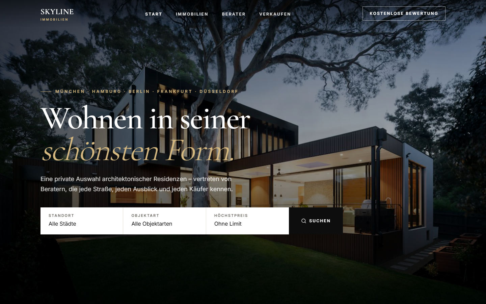

# Skyline Immobilien: demo website

**Live-Demo:** https://PHosseini03.github.io/real-estate/ · **Alle Demos:** https://PHosseini03.github.io/website-showcase/

**The whole site is in German** (formal "Sie"): UI text, demo data, form validation and API error messages. Prices are in euros (`de-DE` format), areas in m², and listings are in München, Hamburg, Berlin, Frankfurt and Düsseldorf.

A luxury, editorial real-estate website in black, ivory and gold, with Cormorant Garamond headings and full-bleed photography. React + TypeScript frontend and a FastAPI backend.

## Features
- Full-screen hero with a property search bar (city, type, max price)
- **Listings** with live filters (city, type, min/max price, bedrooms, sort), all kept in the URL so searches can be shared
- **Property detail** pages with a photo gallery, specs, features, a **Baufinanzierungsrechner** (mortgage calculator: 3.5 % default rate, 20 % equity, 20/25/30-year terms) and the listing agent
- **Private viewing** booking (date + time slot) and a **home valuation** request form, both validated on client and server
- Agents page, city tiles, testimonial, 404 page, offline fallback to bundled demo data
- Fully responsive (360px to 1440px+), keyboard accessible, respects reduced-motion

## Run it
| Part | Port | Command (from this folder) |
|---|---|---|
| API | 8006 | `cd backend; python -m venv .venv; .venv\Scripts\pip install -r requirements.txt; .venv\Scripts\python -m uvicorn app.main:app --port 8006` |
| Web | 5176 | `cd frontend; npm install; npm run dev` |

Open http://localhost:5176. API docs: http://localhost:8006/docs.

## Pages
`/`, `/listings`, `/listings/:id`, `/agents`, `/sell`, and a 404 page for anything else.

## API
| Method | Path | Purpose |
|---|---|---|
| GET | `/api/health` | Health check |
| GET | `/api/listings` | Listings, with filters `city, type, min_price, max_price, beds, sort, featured, limit` (all validated; `city` accepts German umlauts). The `sqft` field holds the living area in m² |
| GET | `/api/listings/{id}` | Listing detail with its agent (404 if missing) |
| GET | `/api/agents` | Agents, sorted by sales |
| GET | `/api/meta` | Cities and property types |
| POST | `/api/viewings` | Viewing request: future date within 180 days, fixed time slots, listing must exist (10/min) |
| POST | `/api/valuations` | Valuation request (10/min) |

All responses use `{ "success": bool, "data": ..., "error": string | null }`.

## Quality
- Backend: `pip install -r requirements-dev.txt; pytest --cov=app` (25 tests, 97% coverage)
- Frontend: `npm test` (24 tests, about 92% statements), `npm run lint`, `npm run build`
- Security: strict Pydantic schemas (extra fields rejected), whitelisted sort columns, parameterized SQL, rate limiting, body-size limit, CORS allow-list, security headers, no secrets in code. `bandit` and `pip-audit` are clean.

*Demo only (Demo-Website – alle Namen, Personen und Zahlen sind fiktiv). The company, agents, listings and prices are fictional. Photos: Unsplash (free licence).*
